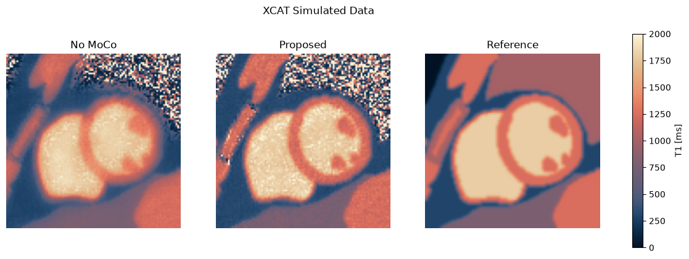

# Joint Zero-Shot Motion Estimation and Iterative Reconstruction for Motion-Corrected Cardiac T1 Mapping

Motion-corrected cardiac T1 mapping from 2D data acquired **continuously over the full cardiac
cycle**. Instead of solving motion estimation, image reconstruction and parametric fitting
sequentially, the method couples them in a single alternating scheme. Motion fields come from a
registration network that is fitted **zero-shot** and **unsupervised** to the single scan being
reconstructed, with no training data and no ground-truth motion or maps.

<!-- TODO: optional method overview figure
<p align="center"></p>
-->

## Method

The k-space data $`\mathbf{y}`$ are modelled as

```math
\mathbf{y} = \mathbf{A}\,\mathbf{M}_{\boldsymbol{\phi}}\,\mathbf{Q}(\mathbf{p}) + \boldsymbol{\epsilon},
```

where $`\mathbf{Q}`$ is the inversion-recovery signal model, $`\mathbf{M}_{\boldsymbol{\phi}}`$ the
cardiac motion operator and $`\mathbf{A}`$ the coil-sensitivity + non-Cartesian Fourier operator.
The motion-corrected parameters are then given by

```math
\mathbf{p}_{\text{MoCo}},\ \boldsymbol{\phi}
\in \arg\min_{\mathbf{p},\,\boldsymbol{\phi}}
\big\|\mathbf{A}\,\mathbf{M}_{\boldsymbol{\phi}}\,\mathbf{Q}(\mathbf{p}) - \mathbf{y}\big\|_2^2 .
```

With variable splitting, this is solved by alternating two subproblems:

```math
\begin{cases}
\boldsymbol{\theta}^{*} \in \arg\min_{\boldsymbol{\theta}} \ \mathcal{L}\big(\boldsymbol{\phi}_{\boldsymbol{\theta}},\boldsymbol{\phi}^{-1}_{\boldsymbol{\theta}},\mathbf{x}_{\text{m}},\mathbf{x}_{\text{r}}\big) & \text{(a) motion estimation} \\[4pt]
\mathbf{p}^{*},\mathbf{x}^{*},\mathbf{c}_j^{*} \in \arg\min_{\mathbf{p},\mathbf{x},\mathbf{c}_j} \ \mathcal{F}\big(\mathbf{p},\mathbf{x},\mathbf{c}_j,\boldsymbol{\phi}_{\boldsymbol{\theta}^{*}}\big) & \text{(b) MoCo reconstruction + regularization + T1 fit}
\end{cases}
```

Here $`\mathbf{x}_{\text{m}}`$ are the moving dynamics: a plain CG reconstruction of the
undersampled data, with no motion correction and no regularization. $`\mathbf{x}_{\text{r}}`$ is a
synthetic motion-compensated reference obtained by fitting the signal model to the frames of
(almost) the same cardiac phase, and it is refined across the outer iterations.

Each outer iteration updates one block at a time:

| Step | Variable | Solver |
|:--:|:--:|---|
| 0 | $`\mathbf{x}_{\text{r}}`$ | reference: signal-model fit on an expanding, ECG-selected subset of frames |
| 1 | $`\boldsymbol{\phi},\ \boldsymbol{\phi}^{-1}`$ | zero-shot CNN registration (mutual information + k-space data consistency + smoothness) |
| 2 | $`\mathbf{c}_j`$ | SVD low-rank coefficients, soft-thresholding |
| 3 | $`\mathbf{x}`$ | conjugate gradient on the quadratic subproblem |
| 4 | $`\mathbf{p}`$ | L-BFGS fit of the signal model, excluding the most systolic frames |

The full derivation, with all loss terms, is in the
[notebook](examples/notebooks/xcat_motion_corrected_t1.ipynb).

## Installation

```bash
git clone https://github.com/guastinimara/Joint-ZS-Motion-Recon-T1-Mapping.git
cd Joint-ZS-Motion-Recon-T1-Mapping

conda create -n zs-moco python=3.11
conda activate zs-moco

# install the PyTorch build matching your GPU driver first. Check the highest CUDA version
# your driver supports with `nvidia-smi` (top right, "CUDA Version"), then pick a build
# that is not newer, e.g. for CUDA >= 12.6:
pip install torch torchvision --index-url https://download.pytorch.org/whl/cu126

pip install -r requirements.txt
```

Main dependencies: [PyTorch](https://pytorch.org/) (>= 2.3.1),
[MRpro](https://github.com/PTB-MR/mrpro) (v0.260420), `numpy`, `scipy`, `matplotlib`,
`einops`, `zenodo_get`. Python 3.10 to 3.13 is supported, as required by MRpro. A CUDA GPU is
strongly recommended. The code falls back to the CPU if none is available.

To check the installation, run the tests from the repository root:

```bash
pytest tests
```

If the code runs on the CPU although `nvidia-smi` shows a GPU, the installed PyTorch was
built for a newer CUDA version than your driver supports (PyTorch prints *"The NVIDIA driver
on your system is too old"*). Reinstall PyTorch from a matching index URL as shown above.

## Usage

Both entry points run the full pipeline on simulated k-space data $\mathbf{y}$, available on
[Zenodo](https://zenodo.org/records/23085535) and downloaded automatically. The data were
simulated to match the in-vivo acquisition. The anatomy and the cardiac motion come from the
XCAT framework, and piecewise-constant parameter values are assigned to each tissue. The
resulting dynamics are deformed with the XCAT motion and sampled with the real acquisition
trajectory and coil sensitivities. The ground-truth maps are on Zenodo too.

| | |
|---|---|
| [`examples/notebooks/xcat_motion_corrected_t1.ipynb`](examples/notebooks/xcat_motion_corrected_t1.ipynb) | step-by-step walkthrough with method description and figures |
| [`examples/scripts/main.py`](examples/scripts/main.py) | the same pipeline as a single script, saves `p_moco.pt` |

```bash
python examples/scripts/main.py
```

### Main building blocks

**T1 estimation.** `T1ParameterEstimator` wraps the transient steady-state inversion-recovery
model and fits $`(M_0, \alpha, T_1)`$ with L-BFGS, optionally on a subset of frames:

```python
from parameters_estimation.T1ParameterEstimator import T1ParameterEstimator

t1_estimator = T1ParameterEstimator(
    sampling_time=SAMPLING_TIME,
    repetition_time=REPETITION_TIME,
    nominal_flip_angle=NOMINAL_FA,
    tau=TAU,
    opt_type='lbfgs',
    device=device,
)
p, qp = t1_estimator.fit(x, mask=frames_to_use)  # p = (M0, flip angle, T1), qp = Q(p)
```

**Motion estimation.** `MotionEstimationWithInverse` fits a 2D attention U-Net, with
consecutive time frames stacked along the channel dimension, that predicts the forward and
inverse motion fields of every dynamic. `MotionOperator` combines MRpro's forward and inverse
motion operators in a single class, and the network writes the estimated fields into it in
place:

```python
from cardiac_motion.MotionEstimationWithInverse import MotionEstimationWithInverse
from operators.MotionOperator import MotionOperator

motion_op = MotionOperator(times=num_dynamics, img_size=img_size, device=device)
motion_estimation = MotionEstimationWithInverse(
    kdata_dynamic=kdata_dynamic,
    acquisition_op=acquisition_op,
    dcf_sqrt_op=dcf_sqrt_op,
    motion_op=motion_op,
    img_size=img_size,
    times=num_dynamics,
    mask_roi=mask_roi,
    device=device,
)
motion_estimation.train_net(x_moving.abs(), x_ref, episodes=40, steps=20, full_loss_phi=35)

(x_registered,) = motion_op.M_op_inv(x_moving)  # apply phi^-1
```

See [`main.py`](examples/scripts/main.py) for how these are combined with the SVD regularizer
and the motion-corrected CG reconstruction in the outer loop.

## Results on simulated data

Output of the notebook on the XCAT phantom: T1 map without motion correction, with the
proposed method, and the ground-truth reference. This corresponds to Figure X of the
[paper](#citation).

<p align="center">
  
</p>

## Repository structure

```
src/
├── cardiac_motion/          # zero-shot registration network (forward + inverse fields)
├── operators/               # motion operator, gradient operators, acquisition operators
├── parameters_estimation/   # T1 signal model fitting
├── regularization/          # SVD low-rank regularizer
├── losses/                  # mutual information, deformation-field regularizers
├── utils/                   # ROI mask, ECG/RR-based frame selection, saving
└── t1_colormap/             # T1 colormap used in the figures
examples/
├── notebooks/               # walkthrough notebook
└── scripts/                 # main.py
```

## Citation

> TODO: add once published.

```bibtex
@article{TODO,
}
```

## License

TODO
